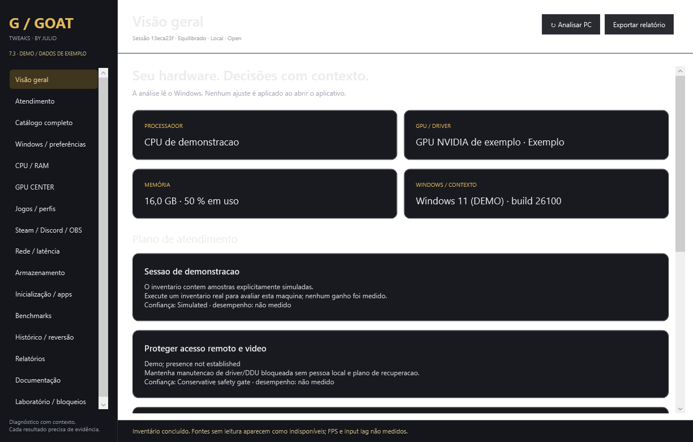

# GOAT Tweaks — 7.3.0 preview

Aplicativo novo, escrito do zero em **Windows PowerShell 5.1 e WPF**, a partir do pacote de requisitos V7.3 + GPU Center fornecido por Julio. Código, interface e motor próprios. A instrução direta do usuário para começar do zero prevaleceu sobre a orientação do pacote para continuar o aplicativo antigo.

O arquivo **`dist/GOAT-Tweaks.ps1` é independente**: inclui interface, módulos, 344 registros de catálogo e 64 documentos. Funciona sem baixar módulos, ferramentas, drivers ou scripts. Requer Windows 10/11 x64; não requer administração para diagnóstico.



## Abrir

Baixe o arquivo `dist/GOAT-Tweaks.ps1` e o checksum correspondente da mesma revisão. Confira o SHA256 antes de executar:

```powershell
Get-FileHash -LiteralPath .\GOAT-Tweaks.ps1 -Algorithm SHA256
powershell.exe -NoProfile -STA -File .\GOAT-Tweaks.ps1
```

Se o Windows bloquear o arquivo baixado, revise a origem e o checksum antes de usar `Unblock-File -LiteralPath .\GOAT-Tweaks.ps1`. O programa não altera a política de execução do sistema.

```powershell
# Interface com dados explicitamente simulados e sem ajustes no Windows
powershell.exe -NoProfile -STA -File .\GOAT-Tweaks.ps1 -Demo

# Inventário JSON sem interface, sem criar uma sessão nem aplicar ajustes
powershell.exe -NoProfile -File .\GOAT-Tweaks.ps1 -ScanOnly

# Na árvore de desenvolvimento, os mesmos argumentos funcionam no launcher da raiz
powershell.exe -NoProfile -STA -File .\GOAT-Tweaks.ps1 -Demo
```

O PowerShell 7 relança o arquivo salvo usando Windows PowerShell 5.1. Para controlar o local das sessões: `-DataRoot 'D:\AtendimentosGOAT'`. Para retomar: `-SessionPath 'D:\AtendimentosGOAT\ID\session.json'` no mesmo modo Demo da sessão original.

## Recursos disponíveis

- 16 áreas navegáveis com tema preto/grafite/dourado e identidade GOAT original desta implementação.
- Inventário de Windows, CPU/RAM, discos, rede, inicialização, Steam/Discord/OBS, reinicialização e sinais de segurança, com origem e falhas explícitas.
- GPU Center NVIDIA/AMD/Intel, múltiplas GPUs, PCI IDs, driver instalado, assinatura quando reportada, OEM de notebook, identificação de monitores e motores de GPU quando disponíveis.
- Guias oficiais de driver e manutenção; DDU permanece manual e bloqueado em contexto remoto ou incerto. Nenhum instalador é executado pelo aplicativo.
- Perfis por jogo com identificação, caminho autorizado, GPU confirmada, resolução/Hz, objetivo, Reflex, VRR, V-Sync, limite FPS e preservação de captura. Mostra conflitos e salva hipóteses locais, sem escrever perfis privados de driver.
- Importação de frametimes CSV/PresentMon, FPS médio, 1% low com método declarado e p50/p95/p99. Comparação exige condições equivalentes e passes independentes. Input lag não é inferido dessas métricas.
- Sessão persistente, prévia de ações, journal durável, read-back, rollback e recuperação por identidade do Windows/usuário. Duas preferências do Explorer têm executores em validação; aplicação real permanece bloqueada, com simulação em Demo.
- Relatório HTML para cliente, JSON/CSV, minimização de dados pessoais e pacote privado de reversão com script independente. Finalização valida os arquivos e preserva a recuperação; pode ser repetida.
- Catálogo pesquisável com 344 requisitos e 64 documentos completos, fontes, hashes, riscos, classes, relações e textos originais. **344 requisitos catalogados não significam 344 ajustes implementados.** Os 41 bloqueios explícitos são preservados.

Consulte [a matriz de funções](docs/FEATURE-MATRIX.md) e [a validação](docs/VALIDATION.md) para conhecer a cobertura real.

## Fluxo de atendimento

1. Abra uma sessão e informe objetivo, contexto local/remoto e autorização de registro.
2. Analise o PC e revise os dados indisponíveis e o plano contextual.
3. Registre um perfil por jogo e suas condições; consulte guias por fabricante/aplicativo.
4. Para benchmark, importe CSV de uma única aplicação/swapchain. Use 3–5 passes distintos por condição e mude somente a variável estudada.
5. Revise histórico e relatório. Clique em **Revisar e finalizar serviço** e escolha o destino da exportação.

Os registros ficam em `%LOCALAPPDATA%\GOAT-Tweaks\Sessions\ID` por padrão. O pacote `private-recovery` contém identidade e snapshots privados: **não publique essa pasta**. Somente `report.html`, `report.json` e `transactions.csv` são projeções destinadas ao cliente, ainda sujeitas à revisão antes de compartilhar.

## Build e testes

```powershell
powershell.exe -NoProfile -STA -ExecutionPolicy Bypass -File .\scripts\Build.ps1
powershell.exe -NoProfile -STA -ExecutionPolicy Bypass -File .\scripts\Test.ps1
```

Saídas: `dist/GOAT-Tweaks.ps1`, `GOAT-Tweaks.sha256`, `build-manifest.json` e `GOAT-Tweaks-7.3.0-preview.zip`. O bundle ASCII contém recursos UTF-8 comprimidos em GZip e Base64, decodificados localmente em memória. O código legível está em `src/`. Não há execução de texto do catálogo ou dos prompts.

Os testes usam mocks de Registro/CIM e dados de captura sintéticos; a UI roda em Demo e exporta para diretório de teste. Nenhum tweak real é aplicado. Há testes reais de inventário somente leitura nesta máquina; isso não certifica outras versões do Windows ou GPUs.

Para regenerar os dados a partir do pacote original:

```powershell
powershell.exe -NoProfile -File .\scripts\Import-Specification.ps1 -SourceRoot 'D:\caminho\GOAT_TWEAKS_V7_3_PACOTE_MESTRE'
```

## Limites da prévia

A matriz física Windows 10/11 + NVIDIA/AMD/Intel e os testes em VM de mutação permanecem pendentes; não há assinatura de distribuição. Por isso, os executores nativos não são liberados para aplicar ajustes reais. Sensores de temperatura, hotspot, clocks, potência e VRAM ficam indisponíveis sem provedor validado. Não há captura ETW, overlay injetado, OC, undervolt, BIOS/UEFI, MSI/HPET/BCD, desativação de segurança, remoção automática de drivers ou promessa de FPS.

O app é portátil: não instala serviço, helper, tarefa agendada nem inicialização automática. Finalizar preserva relatórios e snapshots; não apaga logs do Windows, dados de terceiros ou ferramentas de acesso remoto. Remover o arquivo do aplicativo não desfaz preferências persistentes previamente aprovadas.
